<div align="center">

# Academic Schematic Slides

**Draw the data, not text cards.**<br>
A Claude skill that makes journal-style slides and figures: schematic illustrations first, one point per slide, real typeset maths, and a mandatory visual self-check.

[](LICENSE)
[](#install)
[](skills/academic-schematic-slides/SKILL.md)
[](#how-it-works)
[](skills/academic-schematic-slides/references/math.md)

[Before / After](#before--after) &bull; [Gallery](#gallery) &bull; [Features](#features) &bull; [Install](#install) &bull; [Usage](#usage) &bull; [How it works](#how-it-works) &bull; [FAQ](#faq)

<br>


<sub>One slide produced in this style (synthetic example scene). Every block is a picture of the data or of the network, not a sentence in a box.</sub>

</div>

---

## Before / After

Most generated diagrams look like the left panel: one equal-sized white card per step, text inside, arrows between. This skill is written to produce the right panel instead: the same pipeline, with each thing drawn as what it looks like.

<p align="center">
  <a href="skills/academic-schematic-slides/assets/samples/09_card_vs_schematic.png">
    
  </a>
</p>

| Thing in the pipeline | Card version | Schematic version |
|---|---|---|
| Input image | box reading "Input image" | an image thumbnail |
| Frozen encoder | box reading "Frozen encoder" | a stack of slabs with a snowflake mark |
| Features | box reading "Feature extraction" | a grid of tinted cells |
| Prediction head | box reading "Small prediction head" | a node-and-edge graph |
| Output | box reading "Output map" | a colour-mapped raster with a colour bar |
| Auxiliary branch | two more boxes | a teal dashed *training-only* zone ending in a loss node |

The skill gives the agent a simple check, the **label-removal test**: mentally delete every text label. If you can no longer tell what goes in, what comes out, which part is a network, which part is frozen and which part exists only during training, the figure is a dull card diagram and must be redrawn.

## Why this exists

When an LLM is asked for "a slide" or "a figure", these are the failure modes this skill is written to prevent. Each one has a concrete rule in the skill.

| Typical failure | What the skill does about it |
|---|---|
| White cards with text, chained by arrows | The central rule: boxes hold *operations*, data is *drawn*. A vocabulary table maps each kind of data (image, depth map, vector, token grid, backbone, MLP, loss, ...) to a picture. |
| Slides that are walls of text | One point per slide, a short statement as the title, tiny labels, no information repeated in text that the figure already shows. |
| Maths pasted in as plain text or an unchecked font | All variables and formulas must be truly typeset, including labels inside figures. `references/math.md` lists several typesetting routes. |
| Text running out of boxes, labels under arrows, clipped edges | A checklist (`references/review.md`) and a rule that a slide is not done until the agent has looked at the rendered PNG and zoomed into dense regions. |
| Invented numbers that look like facts | Uncertain content gets a small tag (`unverified`, `estimate`, `to be confirmed`, `illustrative`); untagged means checked against the source. |
| Every slide looks different | Fixed page grid, fixed type sizes, a fixed palette and a fixed meaning for each colour and line style. |

## Gallery

Everything below ships in [`skills/academic-schematic-slides/assets/samples/`](skills/academic-schematic-slides/assets/samples/) as a self-contained SVG plus a 1920&times;1080 PNG. The scenes and numbers are **synthetic and for illustration only** (they are tagged that way on the slides). Click a thumbnail for the full-size PNG.

<table>
  <tr>
    <td align="center" width="50%">
      <a href="skills/academic-schematic-slides/assets/samples/01_cover.png">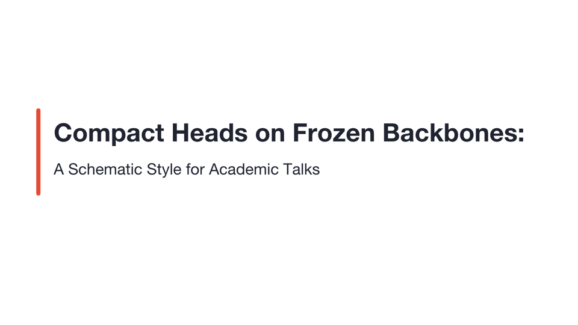</a><br>
      <b>Cover</b><br><sub>Title only: no date, author or logo unless asked.</sub>
    </td>
    <td align="center" width="50%">
      <a href="skills/academic-schematic-slides/assets/samples/02_section.png">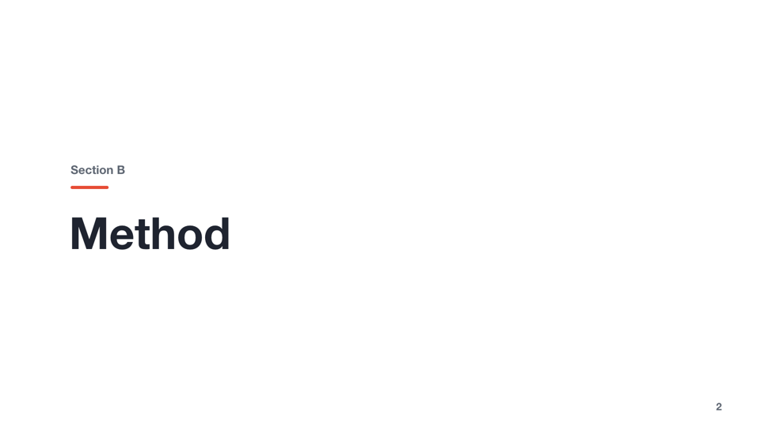</a><br>
      <b>Section divider</b><br><sub>Small label, short rule, large name, nothing else.</sub>
    </td>
  </tr>
  <tr>
    <td align="center">
      <a href="skills/academic-schematic-slides/assets/samples/03_architecture.png">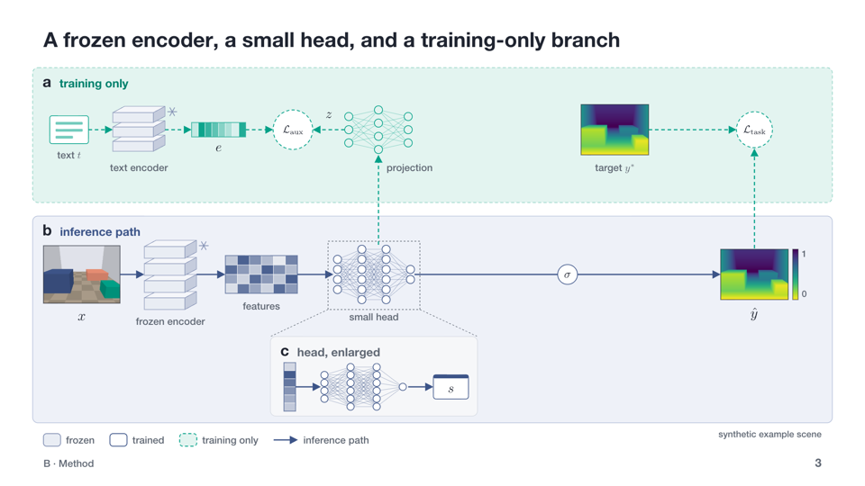</a><br>
      <b>Architecture overview</b><br><sub>Training-only zone above, inference path below, enlarged inset, legend.</sub>
    </td>
    <td align="center">
      <a href="skills/academic-schematic-slides/assets/samples/04_build_step2.png">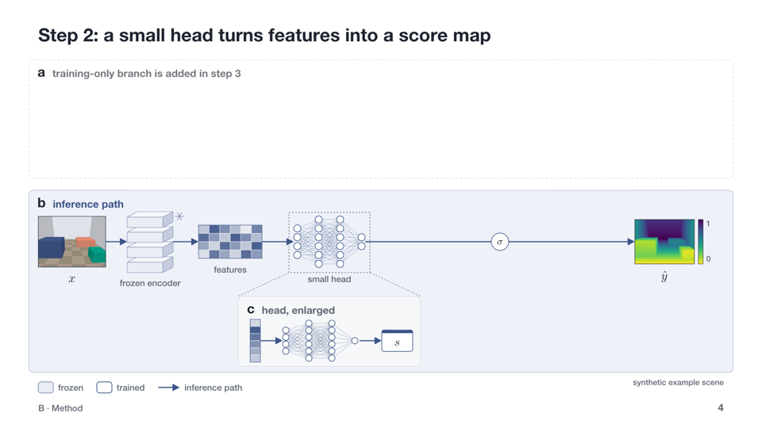</a><br>
      <b>Build-up, step 2</b><br><sub>Base drawing fixed; the training-only panel is reserved and still empty.</sub>
    </td>
  </tr>
  <tr>
    <td align="center">
      <a href="skills/academic-schematic-slides/assets/samples/05_build_step3.png">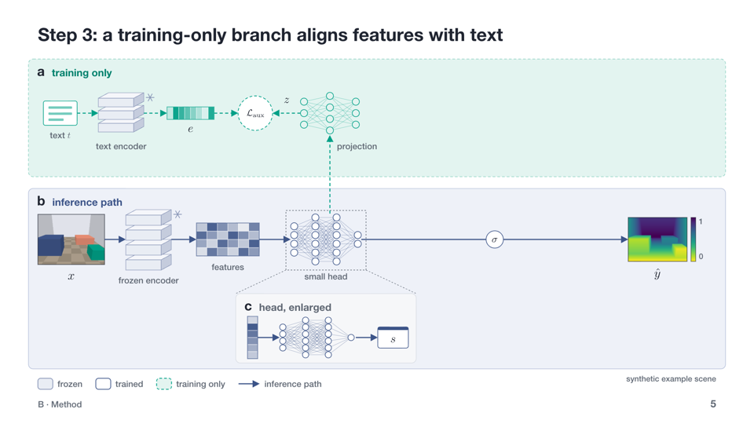</a><br>
      <b>Build-up, step 3</b><br><sub>Same base, exactly one more idea added.</sub>
    </td>
    <td align="center">
      <a href="skills/academic-schematic-slides/assets/samples/06_concept_two_approaches.png">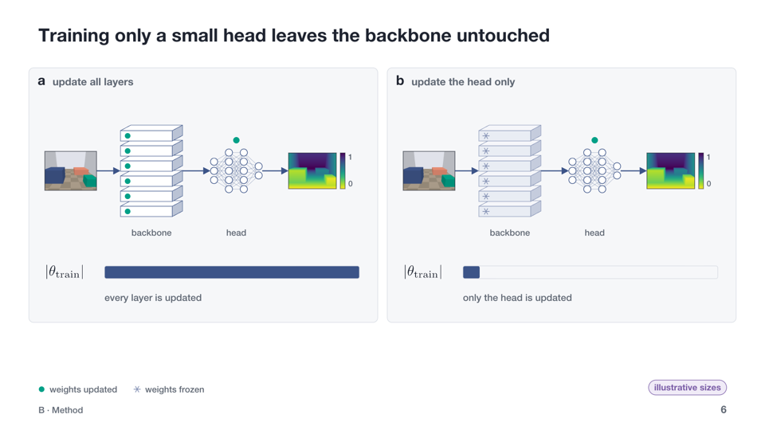</a><br>
      <b>Concept comparison</b><br><sub>Identical components in both panels; only the real difference changes.</sub>
    </td>
  </tr>
  <tr>
    <td align="center">
      <a href="skills/academic-schematic-slides/assets/samples/07_results_chart.png">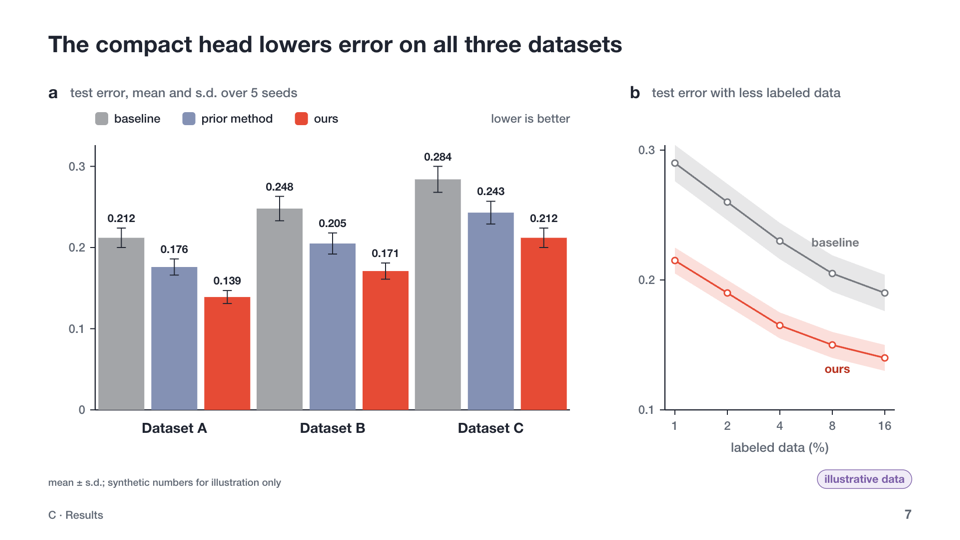</a><br>
      <b>Results chart</b><br><sub>Error bars with stated meaning, direct labels, colour-blind-safe series, honesty tag.</sub>
    </td>
    <td align="center">
      <a href="skills/academic-schematic-slides/assets/samples/08_math_annotated.png">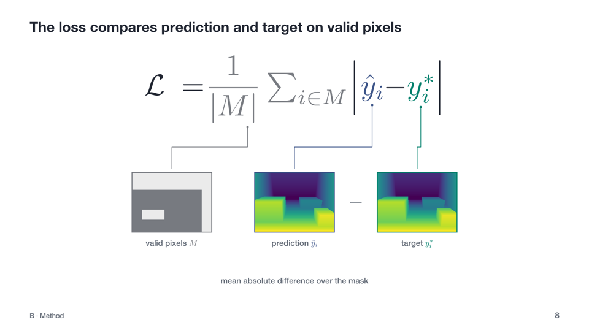</a><br>
      <b>Annotated maths</b><br><sub>Equation typeset in pieces; each term links to a picture in the same colour.</sub>
    </td>
  </tr>
  <tr>
    <td align="center">
      <a href="skills/academic-schematic-slides/assets/samples/09_card_vs_schematic.png">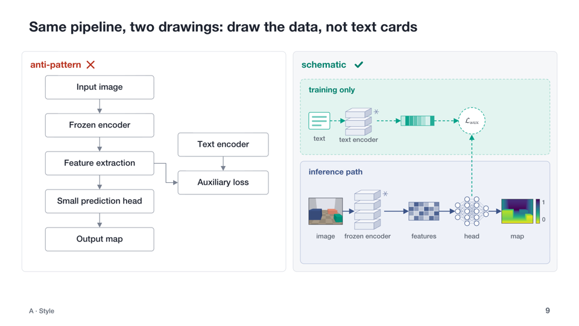</a><br>
      <b>Card vs schematic</b><br><sub>The same pipeline drawn both ways.</sub>
    </td>
    <td align="center">
      <a href="skills/academic-schematic-slides/assets/samples/elements.png">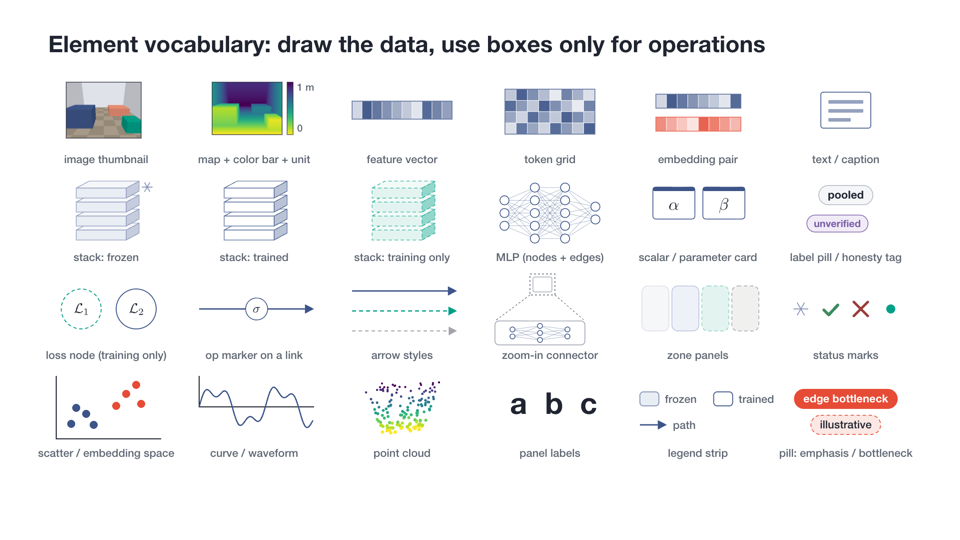</a><br>
      <b>Element vocabulary</b><br><sub>The one-page component sheet the agent copies from.</sub>
    </td>
  </tr>
</table>

## Features

**Figure grammar**
- **Schematic-first.** Boxes are for operations; data is drawn as an image thumbnail, colour map, row of coloured cells, token grid, slab stack, node graph, curve, point cloud, cluster plot, and so on.
- **Label-removal test** to catch card diagrams before they ship.
- **Fixed semantic language**, the same on every slide and explained by a legend that lists only what the slide uses:

  | Meaning | Look |
  |---|---|
  | Frozen / pretrained | blue-grey fill with a small snowflake mark |
  | Trained | white fill, primary-blue outline |
  | Inference path | solid blue arrows on a blue-tinted zone |
  | Training only | teal dashed outline and tinted zone |
  | Removed at inference | grey dashed outline |
  | Emphasis / bottleneck | orange-red, at most one or two per slide |
  | Honesty tag | purple pill |

- **Step-by-step build-ups.** Complex figures are split across slides; each slide adds one idea and the base never moves. Empty dashed placeholders reserve space for parts that come later.
- **Zoom-in insets** linked by dashed connectors, drawn in the same visual language as the main figure.
- **Training above, inference below, flow left to right**, with arrows that never run through labels.

**Content discipline**
- **One point per slide**, a short statement title, minimal text. The cover is the title only.
- **Truly typeset maths**, including labels inside figures; one symbol, one notation for the whole deck; formulas can be set in pieces and annotated with leader lines.
- **Honest labelling.** `unverified`, `estimate`, `to be confirmed` and `illustrative` tags, placed on the element they concern. Sources go bottom-right. Charts built from invented numbers say so.
- **Colour that survives scrutiny.** viridis and cividis stop lists are provided, rainbow/jet is ruled out, every colour map needs a colour bar with range and unit, and colour is never the only carrier of meaning.

**Craft and process**
- **Built-in vocabulary and copy-able SVG recipes** for thumbnails, colour bars, feature vectors, layer stacks, MLP graphs, scalar cards, loss nodes and operation markers, plus [`elements.svg`](skills/academic-schematic-slides/assets/samples/elements.svg), a one-page component sheet.
- **Visual self-check.** There is deliberately no checker script. The agent renders each slide to PNG, looks at it, zooms into dense areas, fixes and re-renders, logs one line per slide, then pages through the whole deck.
- **Generate, do not hand-write.** Shared components are built once and slides are generated by a script, so a style change propagates everywhere.
- **Tool-neutral.** The skill probes the environment (maths route, SVG-to-PNG route, fonts) and records its choice instead of hard-wiring a toolchain.
- **Talks to you in your language.** Slide text is English unless you ask otherwise.
- **Optional illustrative imagery** rules: if an image generator is used, prompts must ask for no text, labels or logos, and the prompt and model are recorded.

## Install

The skill is a folder containing `SKILL.md` plus `references/` and `assets/`. Installing means placing that folder where your agent looks for skills.

### Claude Code

Personal (available in every project):

```bash
git clone https://github.com/YukiHataRin/academic-schematic-slides.git
mkdir -p ~/.claude/skills
cp -r academic-schematic-slides/skills/academic-schematic-slides ~/.claude/skills/
```

Prefer a symlink so `git pull` updates the skill:

```bash
ln -s "$PWD/academic-schematic-slides/skills/academic-schematic-slides" ~/.claude/skills/academic-schematic-slides
```

Project-level (only for one repository, can be committed with it):

```bash
mkdir -p .claude/skills
cp -r academic-schematic-slides/skills/academic-schematic-slides .claude/skills/
```

Or install from the packaged file attached to the [latest release](../../releases/latest) (the zip already contains the top-level `academic-schematic-slides/` folder):

```bash
unzip academic-schematic-slides.skill -d ~/.claude/skills
```

### Claude.ai

1. Download `academic-schematic-slides.skill` from the [latest release](../../releases/latest). It is a zip archive with the skill folder inside; if your browser or the upload dialog insists on `.zip`, rename the extension.
2. In Claude.ai, find the settings area where custom skills are managed and upload the file there. Menu names and plan availability change over time, so follow Anthropic's current documentation for uploading a custom skill.
3. Make sure the features the workflow needs are enabled in your account: the agent must be able to create files and run code (for generating SVGs and rendering PNGs) and to look at the images it makes.

### Other agents that read `SKILL.md`

Put the folder `skills/academic-schematic-slides/` into that agent's skills directory (or point the agent at `SKILL.md`). The content is plain Markdown and SVG with no Claude-specific tooling, but it has only been exercised with Claude here; compatibility elsewhere is expected in principle, not verified.

### Check that it is installed

Start a new session and ask: *"Which skills do you have available?"* The list should include `academic-schematic-slides`. Then try one of the prompts below. If it does not show up, check that the path is `.../skills/academic-schematic-slides/SKILL.md` (one level of folder, not two).

## Usage

You do not need to name the skill or a style. Its description lists triggers such as presentation, slide deck, lab meeting, journal club, paper reading, literature review, thesis or proposal pages, and single diagrams or architecture figures (also 簡報, 投影片, 流程圖, 架構圖, 示意圖, 方法圖, 組會, 文獻研討, 論文導讀), so ordinary requests should activate it. If it does not, mention it by name.

Copy-paste prompts:

**Paper walkthrough (journal club)**
```text
Make a 20-slide journal-club deck for this paper (PDF attached). Explain the problem,
the method figure, the key equations, and the main results. Take numbers only from the paper.
```

**Lab-meeting progress update**
```text
Build 8 slides for my lab meeting: what I tried, one architecture diagram, one results chart
from results.csv, what failed, and next steps. Mark anything you are unsure about.
```

**Research proposal**
```text
Draw the key pages of my research proposal from proposal.md: motivation, gap, approach,
a timeline with milestones, and expected outcomes. Tag every estimate.
```

**One model-architecture figure**
```text
Draw a single Figure 1 for my model: an image encoder (frozen), a small MLP head, a text branch
used only during training, and an auxiliary loss. Show what is used at inference.
```

**Redraw a flowchart as a schematic**
```text
Here is my current flowchart (image attached). Redraw it as a schematic: show the data as what it
looks like and keep boxes only for operations. Keep the same content.
```

**Method figure built up over several slides**
```text
Explain my training pipeline as a step-by-step build-up: backbone, head, training-only branch,
losses, then the inference view. Keep the base drawing fixed across steps.
```

**Results slide**
```text
Make one results slide from this table: three datasets, three methods, mean and s.d. over 5 seeds.
Grouped bars with error bars, colour-blind-safe colours, higher-is-better stated.
```

**Maths slide**
```text
One slide that explains this loss: typeset the equation and connect each term to a small picture
of what it represents.
```

**中文範例**
```text
幫我把這篇論文做成 15 頁的文獻研討簡報，重點放在方法架構圖與主要結果，圖用示意圖風格。
```
```text
請把這份流程圖改成示意圖：資料畫成它實際的樣子，方塊只放運算。
```

What you get back: an outline, one `NN_slug.svg` and `NN_slug.png` (1920&times;1080) per slide, the generator script, a one-line-per-slide review log, and a report listing tagged slides and anything that needs your confirmation.

## How it works

<p align="center">
  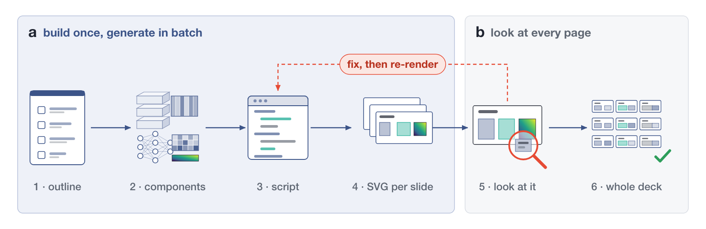
</p>

1. **Outline first.** Slide order, the single point of each slide and its figure type. Content comes from your sources; gaps are marked with tags, never invented.
2. **Choose tools** that the environment really has: maths route, SVG-to-PNG route, fonts.
3. **Build shared components once** (page chrome, panels, arrows, stacks, MLPs, vectors, thumbnails, colour maps, maths helper) and **generate every slide with a script**.
4. **After each slide, render it to PNG and look at it.** Zoom into dense regions, fix, re-render. Log one line per slide.
5. **Finish with a whole-deck pass:** order, colours, line styles, notation, tags, recurring positions.
6. **Report:** output path, slide count, tools used, tagged slides and open items.

Deliverable spec: one SVG per slide with a PNG of the same base name, 1920&times;1080 (16:9), files named `NN_slug.svg` / `NN_slug.png`, SVGs self-contained (embedded rasters and maths as paths, no external files).

## What's inside

```text
skills/academic-schematic-slides/
├── SKILL.md                      Trigger description, core rule, deliverable spec, workflow
├── references/
│   ├── visual-system.md          Palette, type sizes, page grid, strokes, semantic colours, colour maps, SVG boilerplate
│   ├── figure-grammar.md         How to draw: data vocabulary, SVG recipes, zones, insets, build-ups, do/don't
│   ├── slide-patterns.md         Layout of each slide type (cover, section, concept, architecture, results, maths, ...)
│   ├── math.md                   Routes for typesetting maths into SVG, with trade-offs and a tested recipe
│   └── review.md                 What to look for when inspecting each slide and the whole deck
└── assets/samples/               9 sample slides + elements sheet: self-contained SVG and 1920x1080 PNG each
```

| File | Read it when |
|---|---|
| `visual-system.md` | choosing colours, sizes, margins, line styles; changing the look |
| `figure-grammar.md` | drawing any figure (read before drawing anything) |
| `slide-patterns.md` | laying out a specific kind of slide |
| `math.md` | setting up the maths route |
| `review.md` | checking a rendered slide or a finished deck |

## Requirements & tooling

The skill does not bind you to a toolchain; it asks the agent to probe the environment and pick. A setup that covers everything:

| Need | Options named in the skill | Notes |
|---|---|---|
| Maths | **LaTeX + `dvisvgm`** (glyph outlines); MathJax; matplotlib mathtext; pre-rendered formulas | Recommended: LaTeX + dvisvgm, output is pure paths so it survives any rasteriser. |
| SVG to PNG | headless browser, `rsvg-convert`, `cairosvg`, `inkscape` | Whichever you use, confirm that fonts and maths survive the conversion. |
| Fonts | Font stack `Inter, 'Helvetica Neue', Helvetica, Arial, 'Liberation Sans', 'DejaVu Sans', sans-serif` | The agent should confirm which family actually resolves. |
| Python | any | If you use `uv`, tell the agent; it follows your own environment conventions. |

Honest notes:

- **Only one maths path has been tested by the author: LaTeX + `dvisvgm`.** MathJax, matplotlib mathtext and the pre-rendered route are described in `references/math.md` but have not been verified here.
- **No automated checker, no benchmark.** Quality control is the model looking at its own output, so results depend on the model's vision ability. The repository contains no evaluation results.
- **The samples are illustrative.** Scenes are synthetic, and all numbers, dataset names and the cover title are made up (the slides carry `illustrative` / `synthetic` tags).
- **Fonts can shift widths.** Text widths in the sample PNGs depend on which font of the stack resolved on the rendering machine; on a machine with different fonts (for example without `Inter`), widths can differ slightly.
- The agent needs to be able to run code and view images. Without those, the visual self-check cannot happen.
- Nothing is installed for you; the skill reports missing tools and offers options instead of installing system packages.

## Design principles / Customize

The look is defined in one file, [`references/visual-system.md`](skills/academic-schematic-slides/references/visual-system.md): white page, thin lines, low-saturation journal palette, no shadows, no decorative gradients, no emoji, no multi-colour clip-art.

| To change | Where |
|---|---|
| Colours | The palette table and the semantic-language table in `visual-system.md`. Keep each colour's *role* (frozen, trained, training-only, emphasis, honesty tag) consistent. |
| Fonts | The font stack in `visual-system.md`; the typography table lists sizes per element. |
| Page size | Values in `visual-system.md` are written for a 1920&times;1080 canvas (1 SVG unit = 1 px). For another size, rescale the grid, margins and type sizes there. |
| Slide layouts | `slide-patterns.md`. |
| Domain vocabulary | The data-vocabulary table in `figure-grammar.md` (add how your field draws a molecule, spectrum, circuit, ...). |

You can also override things per request, for example: *"Use my lab's blue and grey palette but keep the same meaning for frozen, trained and training-only."*

## FAQ

**Can it output PPTX?**
Not natively. The skill produces SVG and PNG pages. If you need an editable `.pptx`, Google Slides or a PDF from a deck tool, the skill says to use the matching tool for the file but still apply this figure grammar to the pictures: draw the figures as SVG/PNG and place them on the slides.

**What if I do not have LaTeX?**
`references/math.md` describes alternatives (MathJax, matplotlib mathtext, rendered formula images). The skill says the agent must tell you what is missing and offer the best remaining route rather than silently fall back to plain-text maths. As noted above, only LaTeX + dvisvgm has been tested by the author.

**Will it trigger automatically?**
It is designed to: the description names slide, deck, lab meeting, journal club, diagram, architecture figure, schematic and similar words, in English and Chinese, and says it applies even when no style is named. Whether a given agent loads it is up to that agent; mention the skill by name if it does not.

**Why is there no checking script?**
By design. A script cannot judge "is the point obvious in three seconds" or "is this a card diagram", and the skill treats a capable vision model as the checker. `references/review.md` lists what to look for. The trade-off is that the check is only as good as the model doing it.

**Is it only for machine-learning papers?**
The samples use an ML-flavoured example (encoder, head, loss). The grammar is general: the data vocabulary includes time series, histograms, point clouds, graphs, molecules, spectra and more, and you can extend it for your field.

**Is this related to Nature or Springer Nature?**
No. This project is independent and not affiliated with, endorsed by, or sponsored by Nature, Springer Nature or Anthropic. "Journal-style" and "Nature-inspired" only describe the look the skill aims for: white pages, thin lines, a restrained palette.

**Can I change the style?**
Yes, see [Customize](#design-principles--customize).

## Contributing

Issues and pull requests are welcome. Useful contributions:

- New sample slides (timeline, qualitative results, summary, a different scientific domain).
- Component vocabularies for other fields (biology, physics, chemistry, systems, ...).
- Verifying or fixing rendering routes, for example MathJax, matplotlib mathtext, `rsvg-convert`, `cairosvg`, `inkscape`, on different platforms.
- Translations of the README, or of the skill's trigger words.
- Bug reports with the prompt, the agent and version you used, and the rendered PNG.

See [CONTRIBUTING.md](CONTRIBUTING.md). Please keep samples self-contained and honestly tagged.

## License

[MIT](LICENSE) &copy; 2026 YukiHataRin.

## Acknowledgements

- Built for Claude Code and the `SKILL.md` skill format from Anthropic. This project is not affiliated with Anthropic.
- The skill refers to the viridis and cividis colour maps (viridis: van der Walt and Smith; cividis: Nu&ntilde;ez, Anderton and Renslow); the stop lists in `visual-system.md` are their colours, not new inventions.
- No third-party code, fonts or images are bundled.

---

<div align="center">

If this saves you an evening of fighting with boxes and arrows, a star helps other researchers find it.

</div>
